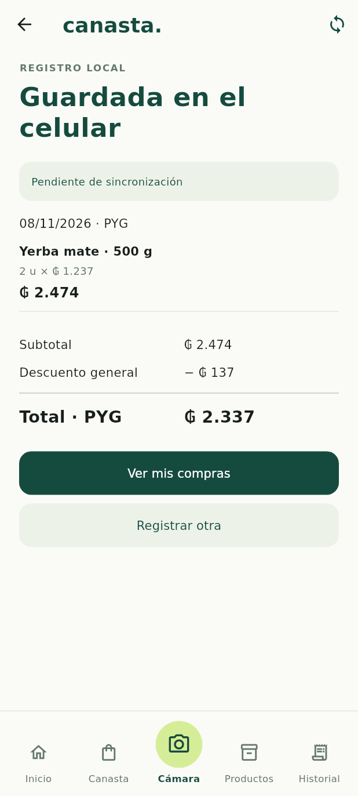

# Guardado local conectado a la pantalla

El punto de entrada `main.dart` abre el almacenamiento privado mediante `InicioLocal` y compone una `SesionLocal`. El recorrido **Cámara → Registrar a mano → Revisar compra → Guardar en el celular → Mis compras** ya usa SQLite real. No depende de la PC ni de una conexión de red.

Los tickets ficticios conservan su vista previa y no se convierten en registros reales. Inicio, Canasta, Productos y Estados siguen como prototipo, con sus etiquetas de datos ficticios. El historial de la aplicación iniciada con sesión local muestra exclusivamente compras de SQLite; no mezcla esos registros con las tres compras de demostración. El constructor sin sesión se conserva para pruebas del prototipo, no como alternativa silenciosa si falla SQLite.

## Qué puede registrarse

El formulario permite varios productos, cantidades con hasta tres decimales, unidad/kg/L, precio unitario, descuento general, total del ticket y fecha/hora. Calcula los renglones con decimal exacto y HALF_UP porque es una carga manual explícita, no una lectura OCR.

Acepta cantidades como `1,5` y guaraníes enteros como `1237` o `1.237`. Nunca trata centavos como guaraníes ni convierte dinero a double. Una diferencia de total bloquea el guardado hasta corregirla expresamente en revisión. No se aplica un ajuste automático.

La fecha/hora manual usa la zona horaria configurada en el dispositivo para producir UTC y conserva por separado el día elegido. No se deduce una zona comercial que el usuario no haya configurado.

El formulario inicial no crea productos de catálogo, comercios ni coincidencias de códigos de barras. Conserva la descripción ingresada, cantidad/unidad, precio y bruto; guarda el contexto conocido de la unidad, dejando datos de catálogo desconocidos en null. Comercio, identificación/organización de productos, descuentos por renglón y edición posterior quedan para otras etapas. Los borradores del formulario todavía no se conservan si se cierra la aplicación antes de guardar.

## Estados y reintentos

El ViewModel recibe `RepositorioCompras` y un generador UUID por inyección; no conoce Drift ni navega. Hay cuatro estados: listo, guardando, error y guardado.

- La primera pulsación fija la compra confirmada, ID de operación y versión base 0. Durante el guardado se deshabilita la acción; pulsaciones repetidas no ejecutan otra solicitud.
- La solicitud fijada no se modifica en el ViewModel después de iniciar el guardado. Reintentar conserva exactamente la misma entidad e ID, incluso si se perdió la respuesta después del commit.
- Solo un recibo con los IDs esperados habilita «Guardada en el celular». Un error o recibo ajeno nunca se presenta como éxito. El mensaje de error no afirma que no se haya escrito: invita a reintentar para resolver un resultado incierto.
- Cerrar la pantalla retira sus listeners. Una escritura ya iniciada puede terminar; no se notifica a un ViewModel destruido ni se intenta cancelar una transacción duradera desde la View.

La prevención de duplicados corresponde a una solicitud y sus reintentos. No identifica dos compras semánticamente iguales introducidas por separado con IDs nuevos.

Tras confirmar el commit se muestra la compra realmente escrita, con un aviso breve de pendiente de sincronización. No hay confirmación remota ni envío a PC. Las pantallas de registro real ya no muestran etiquetas de ejemplo y mantienen pocos textos.

## Historial

`RepositorioCompras.listarRecientes` recupera hasta 100 compras locales, ordenadas por fecha UTC e ID, excluyendo eliminadas lógicamente. El historial permite entrar a sus detalles, actualizar y reintentar errores de lectura; un error no se muestra como una lista vacía.

Cuando alcanza el límite se indica que se muestran las 100 más recientes. No se etiqueta ese conjunto como un total mensual. Las compras restantes permanecen en la base. La retención segura de 30 días, la paginación y los informes siguen pendientes; no se elimina ningún pendiente por antigüedad.

## Arranque, identidad y unidades

SQLite v4 añade `metadatos_locales` y suma **23 tablas**. Guarda un UUID de dispositivo no secreto para conservar identidad entre aperturas. La sesión utiliza una sola base y un repositorio; informa fallos de apertura y permite reintentar, sin sustituirla por una base en memoria ni borrar datos.

Al migrar, si falta esa identidad, se recupera de operaciones, recibos y servidor activo conocidos. Más de una identidad requiere conciliación explícita y se rechaza sin reasignar compras o cola. La migración Drift v2/v3→v4 preserva compras, cola y recibos. Las bases manuales sin versión siguen protegidas frente a adopción/recreación automática.

`DB/unidades-iniciales.json` define IDs compartidos para unidad, kilogramo y litro. Su copia Android se genera junto con el esquema mediante `android/tool/generar_esquema_sqlite.py`. El arranque inserta solo esas unidades y metadatos dentro de una transacción; no inserta compras/productos ficticios. Un símbolo existente con ID/factor/dimensión incompatible exige conciliación y no se sobrescribe. La futura inicialización de PostgreSQL deberá consumir este mismo catálogo antes de sincronizar; no generar otros IDs para esas unidades.

`DB/migrations/sqlite-v004.sql` documenta la ampliación para bases manuales. Cambia únicamente la versión local, no el protocolo ni snapshots v2. La nueva apertura usa el asset consolidado `esquema_v4.json`; se retira el asset v3 anterior.

## Validación

Se añaden **17 pruebas** a las 69 anteriores. Cubren el recorrido con SQLite real, varios productos, precisión de entrada, corrección explícita, guardado sin doble pulsación, error/recibo ajeno, respuesta perdida después del commit, mismo ID de reintento, cierre durante escritura, arranque/reintento, errores de historial, identidad persistente y recuperación/rechazo de identidades heredadas.

El recorrido completo de formulario a detalle del historial también se comprueba a **320 × 568 con texto al 200 %**. Las pruebas anteriores de transacciones y rollback siguen pasando con esquema v4.

- `flutter test`: **86 aprobadas**.
- `flutter analyze`: sin observaciones.
- `flutter build bundle --debug`: correcto, con SDK Android configurado y assets nativos incluidos por el toolchain.

Se añade uuid 4.6.0 y se actualiza pubspec.lock. No se modifican servidor ni API. Estas son pruebas Flutter/SQLite nativas en Linux y compilación de bundle; la apertura privada mediante plugin y los ABI finales del APK todavía requieren verificación en un Android real. La compilación completa de APK continúa pendiente tras el límite de espacio al extraer el NDK en la etapa inicial.

## Captura de referencia

Render Flutter a 412 × 915 de una prueba que guarda un dato introducido de ejemplo en SQLite **en memoria** y recibe su commit. No es una captura de un teléfono ni una compra de una persona. Para el render se cargaron DejaVu Sans y Material Icons; la tipografía final Android puede variar. El test temporal y la base no se versionan.

## Lo que sigue pendiente

Conectar Inicio a los gastos reales y completar el catálogo/canasta. Después integrar cámara/OCR y su revisión, manteniendo la política de fotos temporales. API, vinculación, sincronización exclusivamente por la misma red local y limpieza segura siguen pendientes. Esta entrega no guarda fotografías ni afirma sincronización con la PC.
