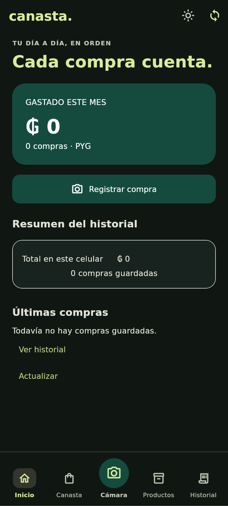

# Vista previa de modo oscuro

Se incorpora tema claro/oscuro en la app existente, sin modificar compras, SQLite, cola ni conectividad. El botón de luna/sol en la cabecera alterna el tema. Por defecto sigue al teléfono; la elección manual se conserva al navegar durante la sesión y no se persiste tras cerrar la aplicación.

La paleta adapta fondo, tarjetas, textos, avisos, botones, navegación, formulario y gráfico. La tarjeta verde de gastos conserva texto blanco en ambos temas. Las superficies que antes eran blancas respetan el tema oscuro; los estados de ejemplo siguen identificados como tales.

Tres pruebas nuevas verifican alternancia sin perder búsqueda, rutas oscuras con texto al 200 % a 320 × 568, y conservación de datos escritos en la carga manual sin crear compras. Resultado: 93 pruebas y análisis sin observaciones.

La captura corresponde a widgets Flutter con SQLite en memoria vacío, a 412 × 915, usando DejaVu Sans y Material Icons para el render de prueba. No es una captura de un teléfono ni datos personales.

El APK instalado por el usuario sigue intacto. Continúa pendiente resolver la firma de actualización antes de recomendar reemplazarlo. Después se retoma la funcionalidad de cámara/OCR, revisión e imágenes temporales; esta entrega no la implementa ni guarda fotos.
