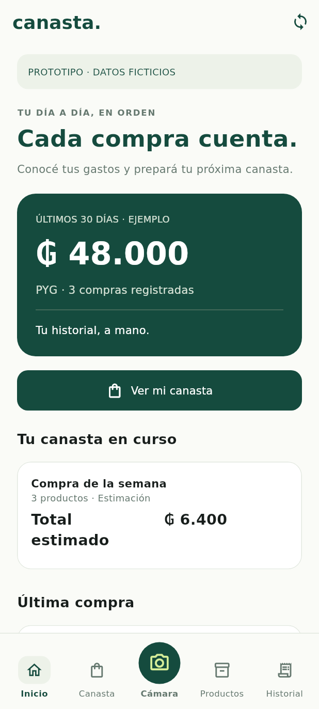
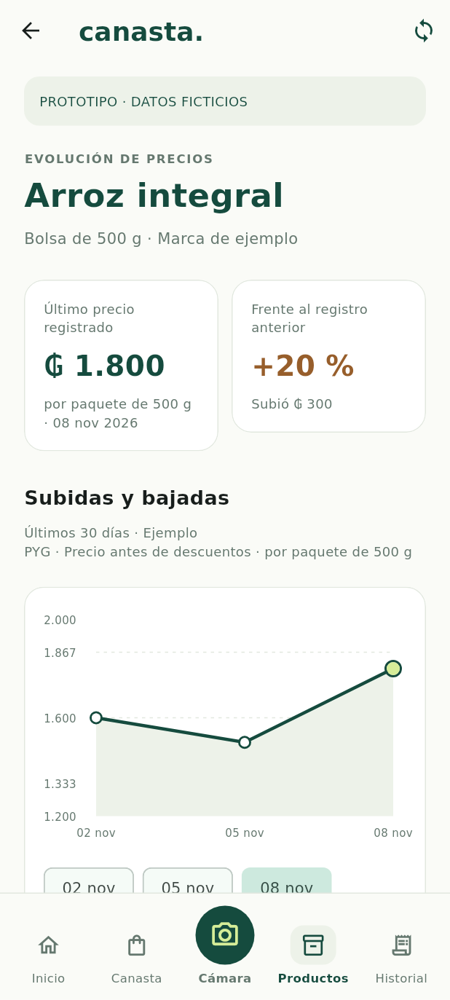
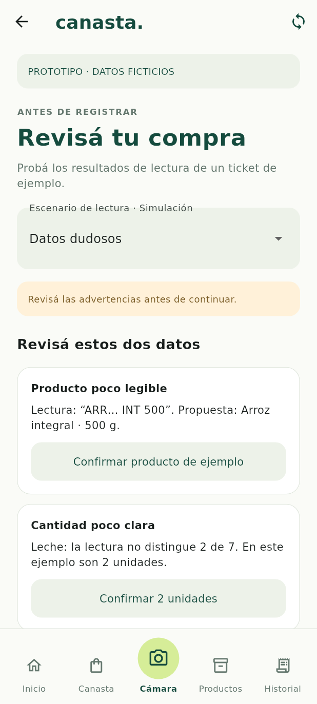

> Informe de la etapa anterior. La integración de revisión se documenta en [repositorios y ViewModel](repositorios-y-viewmodel-revision.md).

# Vistas Flutter de demostración

Se trasladó el prototipo HTML al proyecto Android Flutter, sin conectar servicios. Todas las pantallas muestran «PROTOTIPO · DATOS FICTICIOS». La navegación inferior mantiene Inicio, Canasta, Cámara destacada en el centro, Productos e Historial.

| Ruta | Pantalla y comportamiento visual |
| --- | --- |
| `/` | Inicio: gasto de los últimos 30 días, canasta y última compra |
| `/canasta` | Tres productos y estimación ₲ 6.400 |
| `/captura` | Ejemplo de ticket y política de imagen temporal; no abre cámara |
| `/revision` | Lectura correcta, datos dudosos y total diferente |
| `/historial` | Tres compras, con acceso individual al detalle |
| `/compra` | Productos, cantidades, descuento y total de la compra seleccionada |
| `/productos` | Catálogo con búsqueda local de ejemplo |
| `/producto` | Gráfico, selección de observaciones y precios comparables |
| `/estados` | Siete estados de demostración y sus acciones visuales |

## Datos y revisión

Las compras suman ₲ 48.000; la compra más reciente tiene subtotal ₲ 6.400, descuento ₲ 400 y total ₲ 6.000. Los tres productos presentan observaciones de precio que coinciden con esas compras. El gráfico une observaciones registradas; no representa precios medidos entre compras. Distingue presentación y precio por kg o litro.

La revisión dudosa exige comprobar producto y cantidad. El total diferente exige corregirlo explícitamente antes de habilitar la confirmación. Cambiar el escenario restablece esas verificaciones. Confirmar muestra un detalle simulado y no persiste ni duplica compras.

Estados: sin compras, canasta vacía, ticket ilegible, guardada en el celular, pendiente, error al sincronizar y sincronizada. Reintentar un error solo cambia la demostración a pendiente; no ejecuta solicitudes ni anuncia una sincronización real.

## Separación de responsabilidades

`lib/demo/` contiene ejemplos inmutables de presentación, no entidades persistentes ni contratos de API. Las Views mantienen exclusivamente selección, búsqueda y verificaciones visuales. Los futuros ViewModels coordinarán reglas y repositorios. No se agregaron conexiones, cámara, OCR ni almacenamiento de imágenes.

Se conservan las decisiones: fotos tomadas desde la app temporales, guaraníes sin decimales, últimos 30 días en el celular sin eliminar compras no sincronizadas, PC con historial completo y sincronización exclusivamente en la misma red local. Estas políticas todavía no se ejecutan en este prototipo.

## Validación

- `flutter analyze`: sin observaciones.
- `flutter test`: diez pruebas aprobadas, con errores de pulsaciones fallidas tratados como fallos.
- `flutter build bundle --debug`: compilación Dart aprobada; no equivale a generar un APK.
- Se verificaron las nueve rutas a 320 × 568 y texto al 200 %, además de navegación, filtros, importes, coherencia de observaciones, revisión y estados.

La compilación nativa y la ejecución en un Android real siguen pendientes. En la etapa anterior el entorno se quedó sin espacio al extraer el NDK; esta etapa no repitió esa descarga ni valida cámara, OCR, SQLite, red o Windows.

## Capturas de referencia

Renders de widgets Flutter a 412 × 915 con datos ficticios. Se cargaron DejaVu Sans y Material Icons para la captura de pruebas; el aspecto tipográfico final en Android puede variar. No son capturas de un dispositivo ni de servicios funcionando.

## Textos de la versión final

Decisión del usuario: mantener pocos textos en la app. Las etiquetas «prototipo», «datos ficticios» y las explicaciones de prueba se retirarán al conectar funciones reales. Conservar títulos, importes, acciones breves y avisos necesarios; los detalles secundarios se mostrarán solo cuando se soliciten. Durante la demostración se mantiene la identificación para evitar confundir ejemplos con datos reales.

## Próxima etapa

Definir e implementar modelos y reglas de importes, cantidades y revisión con interfaces de repositorios y ViewModels. Conectar almacenamiento y servicios posteriormente, de acuerdo con los contratos documentados.
